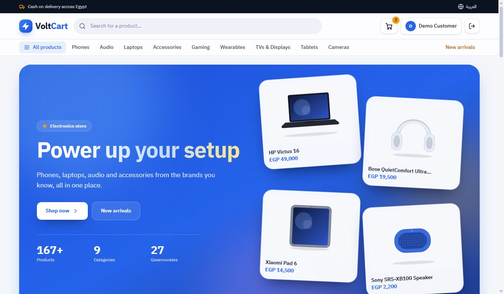
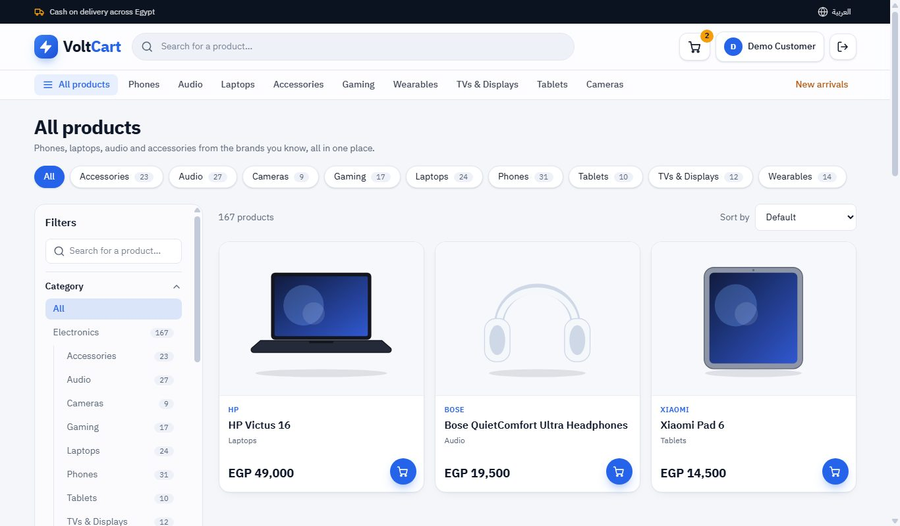
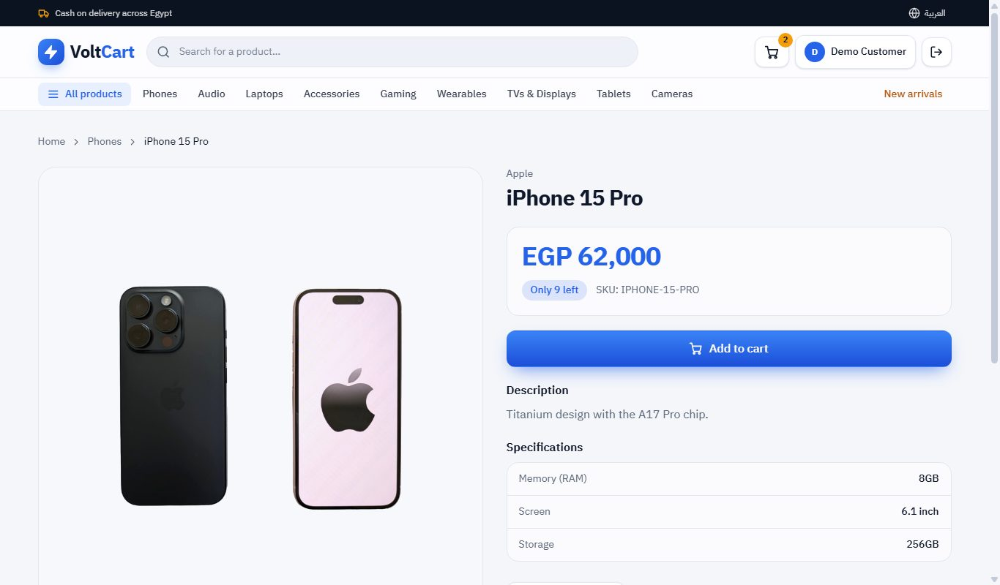
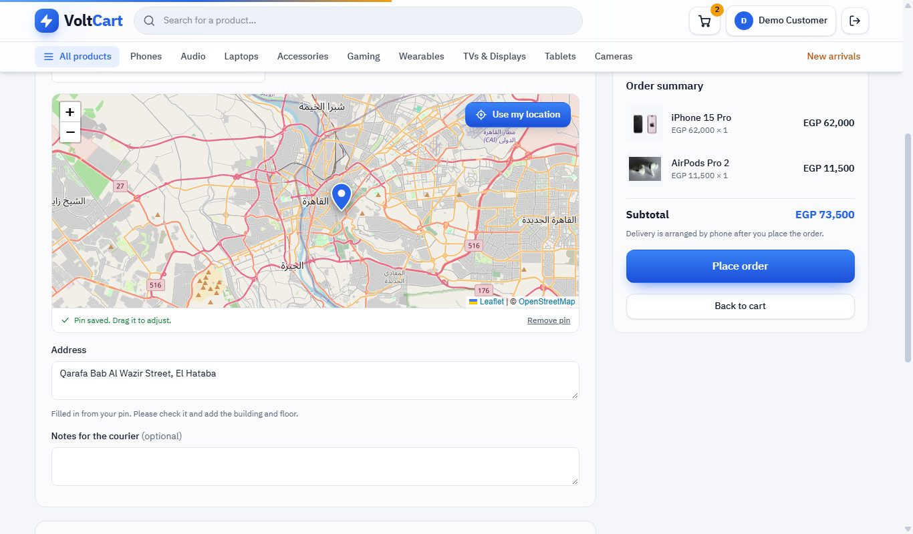
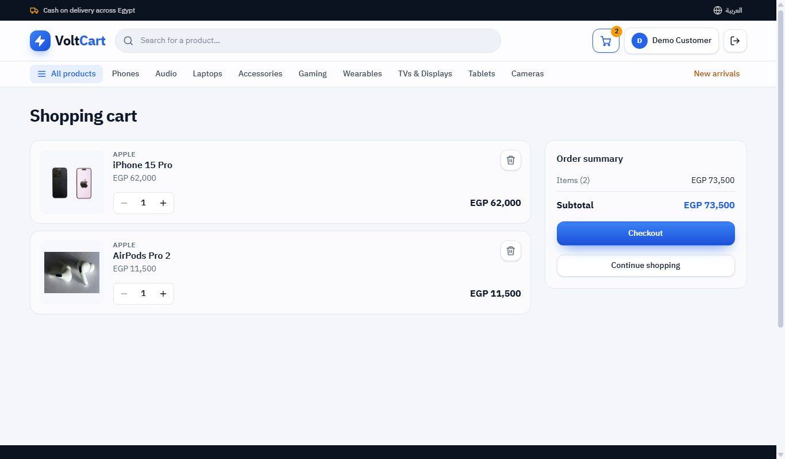
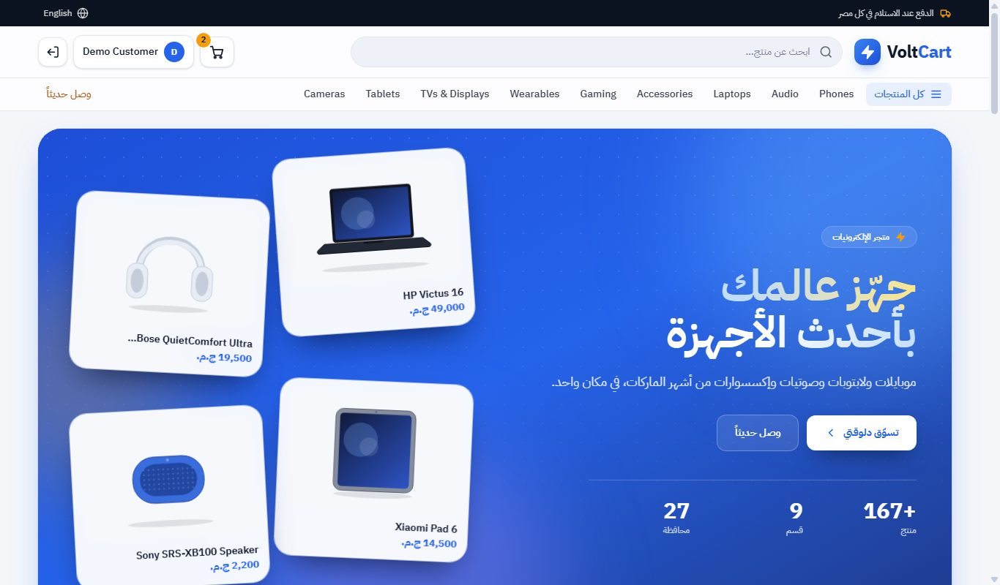
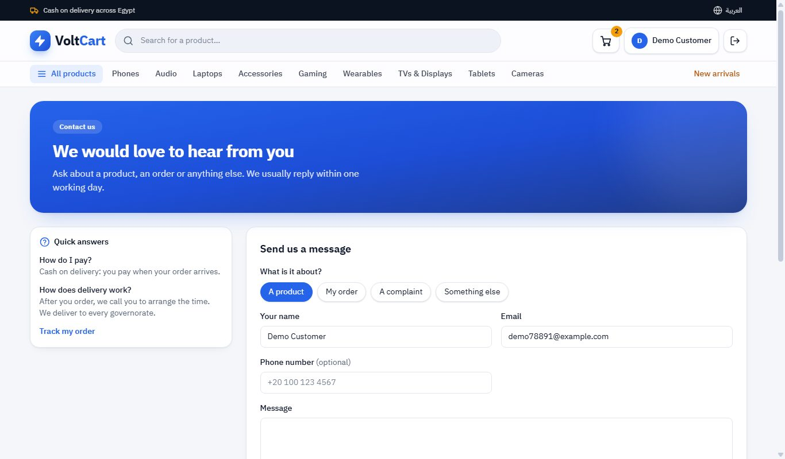
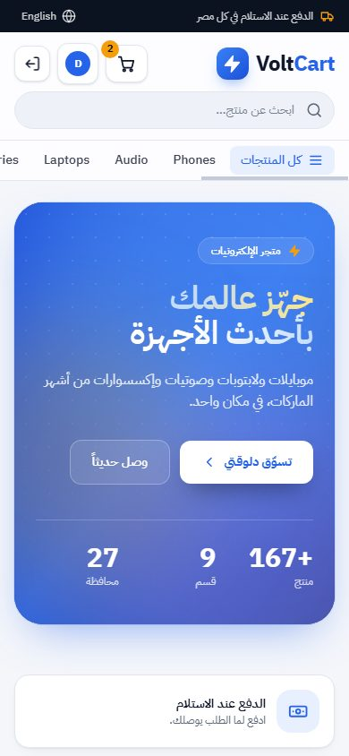

# VoltCart

[](https://github.com/Ahmmedelsaid/VoltCart/actions/workflows/ci.yml)

A full-stack electronics store for Egypt: **Angular 21** single-page app, **.NET 10** Web API and **MySQL**.
Arabic and English (with proper RTL), cash on delivery, and a map pin at checkout so the courier finds you.



|                                         |                                         |
| --------------------------------------- | --------------------------------------- |
|  |  |
|  |  |
|  |  |

<p align="center"></p>

## What it does

**Shopping**
- Catalogue of ~170 demo products in 9 categories with search, category/brand/price filters, sorting and pagination.
  All filter state lives in the URL, so every view is shareable and the back button works.
- Product pages with specs and stock status; a server-side cart that follows the user across devices.
- Checkout with **Cash on delivery**, a governorate list, and a **Leaflet / OpenStreetMap pin**. Dropping the pin (or
  "Use my location") suggests the address and governorate through a small cached, rate-limited API endpoint.
- Order history, order details and cancel (stock goes back, exactly once).

**Accounts and trust**
- Register / sign in with a short-lived JWT access token plus a rotating, hashed refresh token in an HttpOnly cookie.
- Rate limiting on auth, contact and geocoding endpoints.

**Content and communication**
- Home, About and Contact pages. The contact form saves every message and emails the shop.
- HTML emails (with a plain-text twin) for contact messages, order confirmations (Arabic + English) and new-order alerts.
- Arabic / English UI with full RTL layout, remembered per browser.

**Polish**
- Responsive layout, keyboard and screen-reader friendly forms, focus moves to the first invalid field.
- Motion (scroll reveals, animated hero, page transitions) that switches off with `prefers-reduced-motion`.

## Tech stack

| Area | Tools |
| --- | --- |
| Frontend | Angular 21 (standalone components, signals, zoneless, `OnPush`, lazy routes), TypeScript, RxJS, Reactive Forms, Tailwind CSS v4, Transloco (i18n), Leaflet |
| Backend | .NET 10 Web API, EF Core 9 + Pomelo MySQL (migrations), JWT bearer auth, ASP.NET rate limiting, MailKit |
| Database | MySQL 8 |
| Testing | Vitest + jsdom (Angular unit tests), HttpTestingController |
| Tooling | Prettier, CSharpier, GitHub Actions |

## Things worth a look

- **No overselling.** Placing an order decrements stock with a conditional `ExecuteUpdateAsync`
  (`WHERE stock >= qty`) inside a transaction, so two customers racing for the last unit give one `201` and one `409`.
- **Interceptors and error handling.** A ProblemDetails interceptor turns every API error into one typed shape; an auth
  interceptor refreshes the token once and replays the request.
- **State with signals.** Cart, auth, toasts and language are small signal-based services; components stay `OnPush`.
- **URL as the source of truth** for catalogue filters (`toQuery` / `toUrlParams`), covered by unit tests.
- **Resilient email.** Emails go through a bounded queue and a background service, so a slow or broken SMTP server never
  slows down or fails a request. User input is HTML-escaped in every email.
- **Idempotent dev seeding.** The seeder only adds what is missing and never overwrites existing rows.

## Getting started

Prerequisites: **.NET 10 SDK**, **Node.js 22+**, **MySQL 8**.

```bash
# 1. Restore local tools (EF Core CLI, CSharpier)
dotnet tool restore

# 2. Configure the API secrets (stored outside git)
dotnet user-secrets set "ConnectionStrings:Default" "Server=localhost;Database=voltcart;User=root;Password=..." --project api
dotnet user-secrets set "Jwt:Key" "<at least 32 random characters>" --project api

# 3. Create the database and run the API  (http://localhost:5034)
dotnet ef database update --project api
dotnet run --project api          # in Development it seeds the demo catalogue on start

# 4. Run the web app  (http://localhost:4200)
cd web
npm install
npm start
```

Optional first admin account (nothing is created unless you set both):

```bash
dotnet user-secrets set "Seed:AdminEmail" "admin@example.com" --project api
dotnet user-secrets set "Seed:AdminPassword" "<a strong password>" --project api
```

### Tests

```bash
cd web && npm test            # 90 unit tests
dotnet build api              # API build
```

### Email (optional)

Contact messages and orders are always saved. With SMTP configured they are also emailed. `appsettings.json` only holds
the host and port; keep the rest in user-secrets:

```bash
dotnet user-secrets set "Email:UserName" "you@gmail.com" --project api
dotnet user-secrets set "Email:Password" "<gmail app password>" --project api
dotnet user-secrets set "Email:ContactRecipient" "where-to-receive@example.com" --project api
```

- Gmail needs 2-step verification and an **App password** (Google Account > Security > App passwords).
- New-order alerts go to `Email:OrderRecipient`, or to `Email:ContactRecipient` when that is not set.
- Set `Email:WebUrl` to the public address of the site so links inside emails are right.
- The API console shows `Email sent: ...` on success. `SMTP login was refused` means the password is not an App
  password. `Email__LogProtocol=true` prints the SMTP conversation (passwords are hidden).
- In production use environment variables (`Email__UserName`, `Email__Password`, ...).

### Shop details and WhatsApp

Phone, support email, address, hours and the WhatsApp number live in `web/src/app/core/site.ts`. Empty fields are hidden.
With a WhatsApp number set, the Contact page gets a WhatsApp card and order pages get a "Send my order on WhatsApp"
button (a `wa.me` link with a ready message; fully automatic messages would need a WhatsApp Business API account).

## Project structure

```
api/
  Controllers/   REST endpoints (products, cart, orders, auth, contact, geocode)
  Models/ Dtos/  EF entities and request/response shapes
  Data/          DbContext, demo catalogue seeder (SeedCatalog), admin seeder
  Services/      Token service, email queue/sender and the HTML email templates
web/src/app/
  core/          API services, auth, cart, i18n, interceptors, geo data
  features/      home, products, cart, checkout, orders, account, auth, about, contact, credits
  layout/        header
  shared/        UI pieces, directives (reveal, count-up), pipes
```

## Notes

- Products and prices are demo data. Most product images are generated illustrations; a few real photos come from
  Wikimedia Commons under free licences (see the in-app **Photo credits** page and `web/public/images/products/real/credits.json`).
- Payment is cash on delivery only. There is no admin UI yet; product and order management endpoints exist in the API for the
  `Admin` role.
